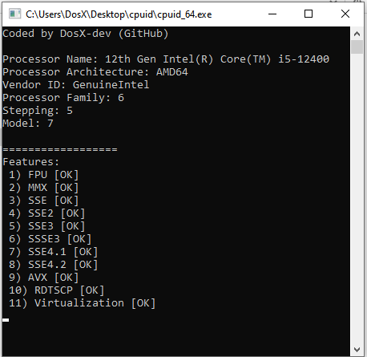

# ```cpuid``` using example
An example of identifying a processor through the "cpuid" instruction (is used to retrieve information about the processor, including details about its architecture, vendor, features etc)

### [Download compiled as .EXE](https://github.com/DosX-dev/cpuid-in-C/releases/tag/Builds)


> [!TIP]
> Build with **[TinyCC for Windows](https://github.com/DosX-dev/TinyCC-builder/releases/latest)**. Includes a tool to automatically<br>
> download and update **[obfus.h](https://github.com/DosX-dev/obfus.h)** for protecting your own C projects.
